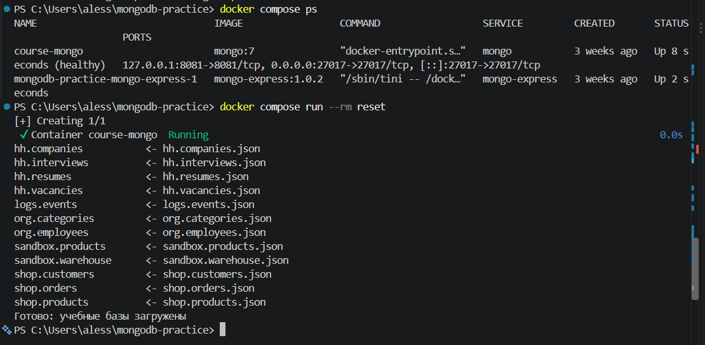
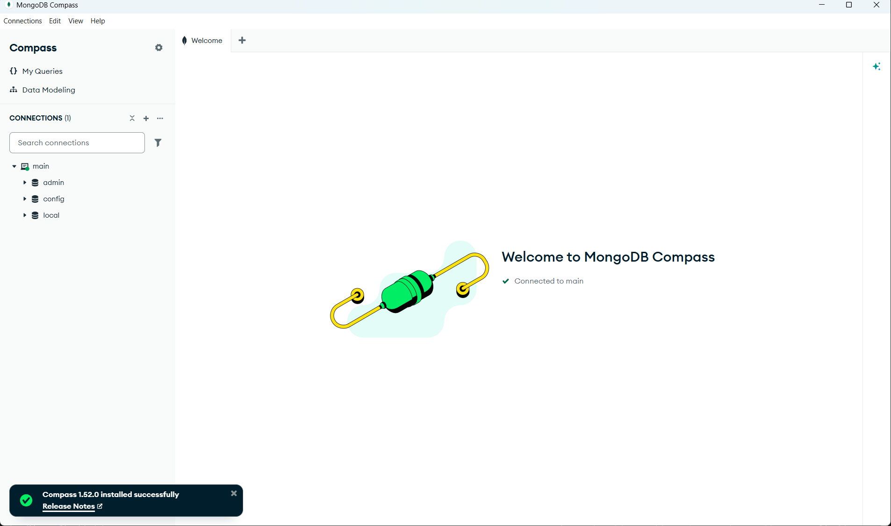
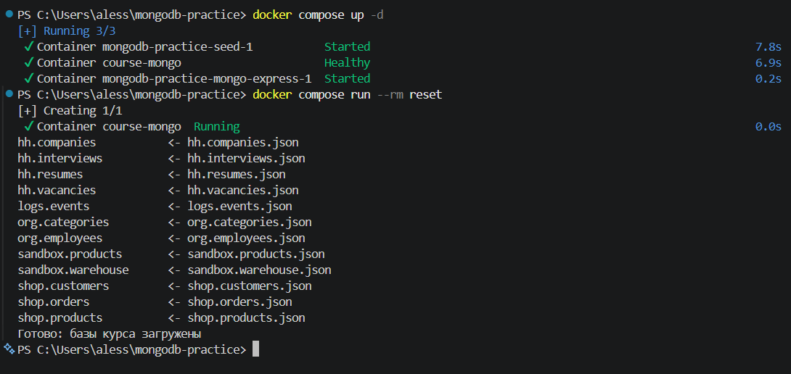
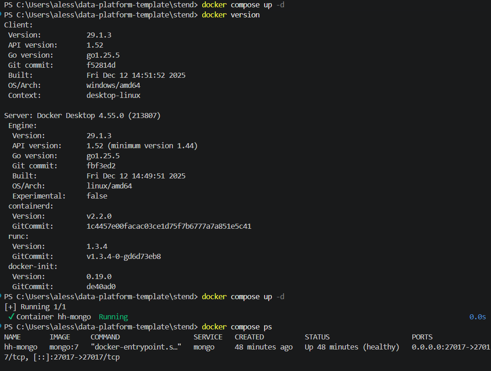
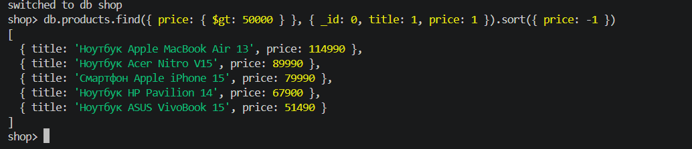
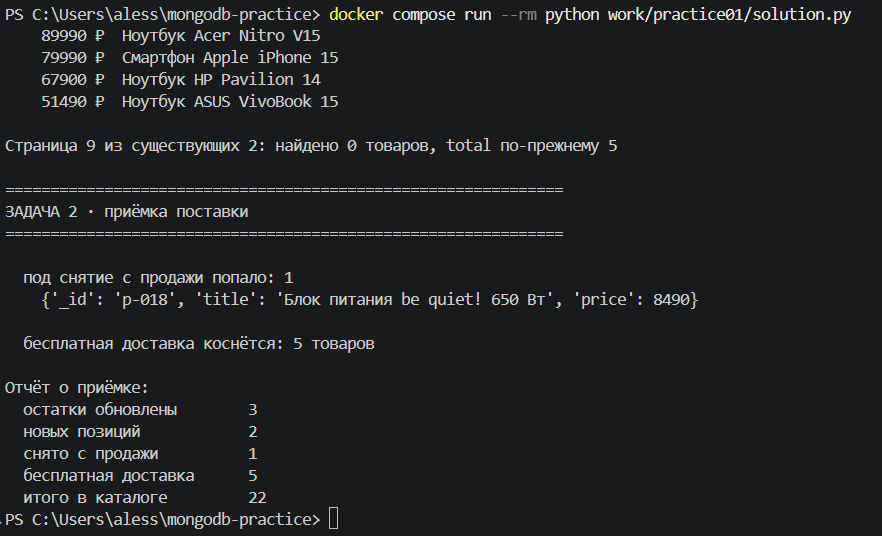
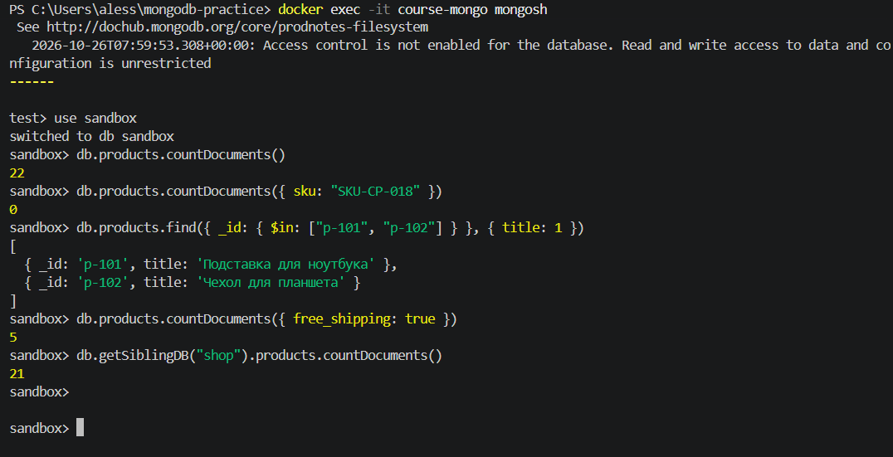

# Скриншоты домашней работы № 3

Сюда положите шесть кадров из вашей практической работы:

1. `01-program-start.png` — запуск программы;

2. `02-products-created.png` — создание или загрузка товаров;

3. `03-catalog-result.png` — вывод каталога;
](03-catalog-result.png)
4. `04-search-result.png` — поиск или фильтрация;

5. `05-update-or-delete-result.png` — изменение/удаление или следующий результат,
   если такой операции нет;

6. `06-database-check.png` — проверка результата в MongoDB.

Кадры должны быть сделаны на вашем компьютере. Скриншоты из справочника
не заменяют подтверждение собственной работы.

