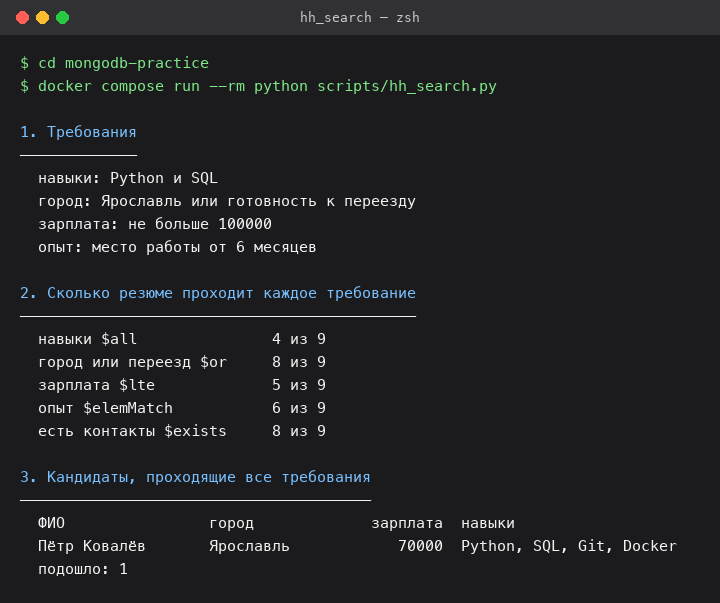
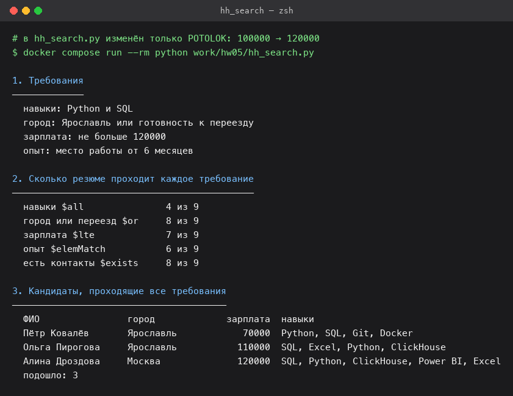
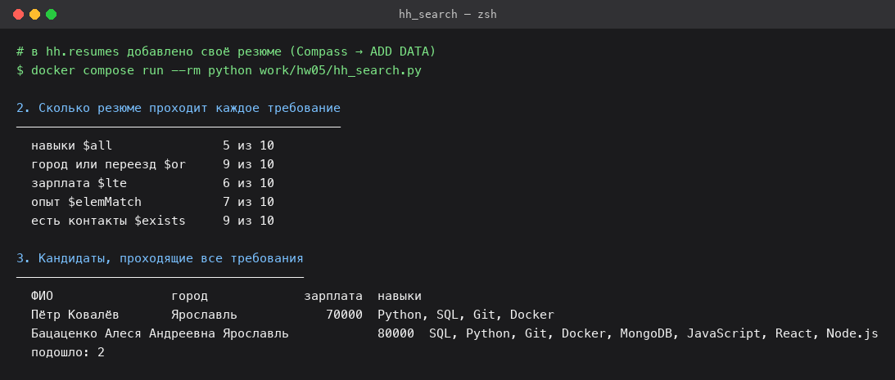

# Домашнее задание № 5 · Скрипт подбора кандидатов

**Студент:** Бацаценко Алеся Андреевна

Глава 2.9 справочника:
<https://maximbytecamp.github.io/mongodb_theory_makarov/temy/18-skript-podbor/index.html>

Скрипт — `scripts/hh_search.py` из репозитория практик,
язык Python (PyMongo). База `hh` из `mongodb-practice`: в `resumes` 9 резюме,
в `vacancies` 8 вакансий, в `interviews` 60 собеседований. Стенд поднят
командами `docker compose up -d` и `docker compose run --rm reset`, запуск из
корня клона:

```bash
docker compose run --rm python scripts/hh_search.py
```

## 1. Восемь разделов отчёта и их операторы

| Раздел | Чем сделан | Глава |
|---|---|---|
| 1. Требования | значения в переменных `NAVYKI`, `GOROD`, `POTOLOK`, `OPYT_MESYACEV`, из них собираются фильтры | — |
| 2. Каждое требование по отдельности | `$all`, `$or`, `$lte`, `$elemMatch`, `$exists` — по одному `count_documents` на условие | 2.2–2.6 |
| 3. Все требования сразу | те же условия в одном фильтре (пары верхнего уровня — «и», `$or` внутри) и `sort("salary", 1)` | 2.1, 2.4 |
| 4. Должности с Junior | `$regex` с шаблоном `^junior` и `$options: "i"` | 2.7 |
| 5. Вакансии под ожидание | точечная нотация `salary.from` / `salary.to` с `$lte` и `$gte` | 2.1, 2.2 |
| 6. Собеседования за неделю | период полуинтервалом: `$gte` 21 сентября, `$lt` 28 сентября | 2.2 |
| 7. Проверка данных | `$exists`, `$not` + `$type`, `$size`, `"skills.0"` + `$exists`, `$expr` с `$gt`, `$ne` | 2.5, 2.6, 2.8 |
| 8. Кто не прошёл отбор | запроса нет: скрипт читает все резюме и сравнивает поля средствами Python | — |

Раздел 8 — единственный без операторов: фильтр отвечает, какие документы
подходят, но не объясняет причину отказа, поэтому причины собирает сама
программа (`set(NAVYKI) <= set(doc["skills"])`, сравнение `salary` с
`POTOLOK` и т. д.).

## 2. Таблица запусков

Менялась одна переменная, остальные возвращались к исходным
(`NAVYKI = ["Python", "SQL"]`, `GOROD = "Ярославль"`, `POTOLOK = 100000`,
`OPYT_MESYACEV = 6`). Число — строка «подошло» из раздела 3.

| Что изменено | Подошло кандидатов | Кто |
|---|---|---|
| ничего, исходные требования | 1 | Пётр Ковалёв |
| навыки: только `Python` (убрана `SQL`) | 2 | Пётр Ковалёв, Марк Ефремов |
| навыки: только `SQL` (убран `Python`) | 1 | Пётр Ковалёв |
| город: `Санкт-Петербург` | 0 | — |
| потолок зарплаты: 110 000 | 2 | Пётр Ковалёв, Ольга Пирогова |
| потолок зарплаты: 120 000 | 3 | Пётр Ковалёв, Ольга Пирогова, Алина Дроздова |
| срок работы: 4 месяца | 2 | Пётр Ковалёв, Ксения Лапина |
| срок работы: 14 месяцев | 0 | — |
| добавлено своё резюме | 2 | Пётр Ковалёв, Бацаценко Алеся Андреевна |

Числа раздела 2 при исходных требованиях: навыки `$all` — 4 из 9, город или
переезд `$or` — 8 из 9, зарплата `$lte` — 5 из 9, опыт `$elemMatch` — 6 из 9,
контакты `$exists` — 8 из 9. Самое жёсткое требование — навыки, самое мягкое —
город: его проходит 8 резюме из 9.

## 3. Скриншоты



Разделы 1–3 при исходных требованиях: подошёл один кандидат.



Изменено одно требование — потолок зарплаты 100 000 → 120 000; подошло трое.



Своё резюме, добавленное в `hh.resumes`, скрипт нашёл в разделе 3.

## 4. Своё резюме

Добавлено в `hh.resumes` через Compass (ADD DATA) — документ лежит рядом:
[`svoi-rezume.json`](svoi-rezume.json). Данные взяты из портфолио
<https://alessstft.github.io/>: Бацаценко Алеся Андреевна, специализация —
фронтенд с опытом полного цикла, из навыков взяты те, что перечислены в
разделе «Разработчик». Резюме проходит все исходные требования:

- навыки: `SQL`, `Python`, `Git`, `Docker`, `MongoDB`, `JavaScript`, `React`,
  `Node.js` — в фильтре стоит `$all` по `Python` и `SQL`, остальные просто
  перечислены в резюме;
- город Ярославль, зарплата 80 000 (не больше потолка 100 000);
- опыт — два места работы по 8 и 6 месяцев (не меньше 6);
- дата обновления и контакты заполнены (почта и Telegram из портфолио).

Скрипт нашёл его в разделе 3, после работы база возвращена командой
`docker compose run --rm reset`.

## 5. Вывод: какое требование смягчить

Смягчить надо **потолок зарплаты: 100 000 → 120 000**. Тогда кандидатов
становится 3 — Пётр Ковалёв (70 000), Ольга Пирогова (110 000) и
Алина Дроздова (120 000).

Почему именно зарплата. Раздел 2 показывает, что по отдельности зарплату
проходят 5 резюме из 9, то есть само требование не самое узкое. Важнее,
на чём падают кандидаты. Раздел 8 перечисляет причины отказа: из восьми
отказавших четверо не проходят ровно одно требование — Марк Ефремов
(навыки: у него `Python` без `SQL`), Ксения Лапина (опыт: 4 месяца),
Ольга Пирогова и Алина Дроздова (зарплата: 110 000 и 120 000). Остальные
отсеиваются сразу по двум-трём условиям, и одно смягчённое требование их
не вернёт: например, у Игоря Самойлова и Тимура Валиева нет навыков, и
зарплата не выше потолка их тоже не устроит.

Значит, смягчать надо то требование, на котором висят сразу несколько
кандидатов с одной причиной отказа, — это зарплата: она держит двоих.
Навыки дают только одного (Марка), опыт — одного (Ксению): и то и другое
доводит отбор до 2 человек, а не до 3.

Значение — ровно 120 000, это проверено запусками: при потолке 110 000
проходит 2 кандидата (Пётр и Ольга, Алина с зарплатой 120 000 отсеивается),
при 120 000 — 3. Дальше поднимать потолок нет смысла: при 150 000 и выше
остаются те же трое, следующий кандидат (Тимур Валиев, 140 000) не проходит
по навыкам.

Проверка остальных вариантов: навыки только `Python` — 2, только `SQL` — 1,
срок работы 4 месяца — 2, 14 месяцев — 0, город `Санкт-Петербург` — 0
(требование по городу и так проходит 8 резюме из 9).

## Как переснять замеры

```bash
git clone https://github.com/MaximBytecamp/mongodb-practice.git
cd mongodb-practice
docker compose up -d
docker compose run --rm reset
docker compose run --rm python scripts/hh_search.py
```

Для замеров с изменённым требованием скрипт скопирован в
`work/hw05/hh_search.py`, там правится нужная переменная, запуск —
`docker compose run --rm python work/hw05/hh_search.py`. Своё резюме
добавляется через Compass (ADD DATA, файл `svoi-rezume.json`); в конце
работа возвращается командой `docker compose run --rm reset`.

## Сдача

Ветка `hw-05`, Pull Request в свою `main`.
