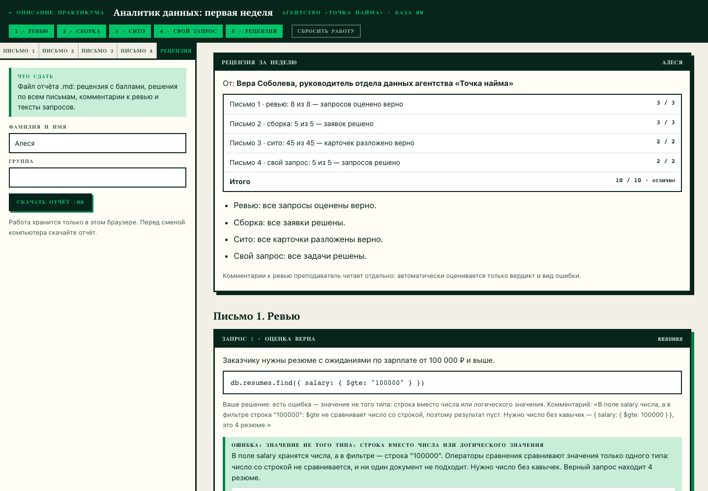
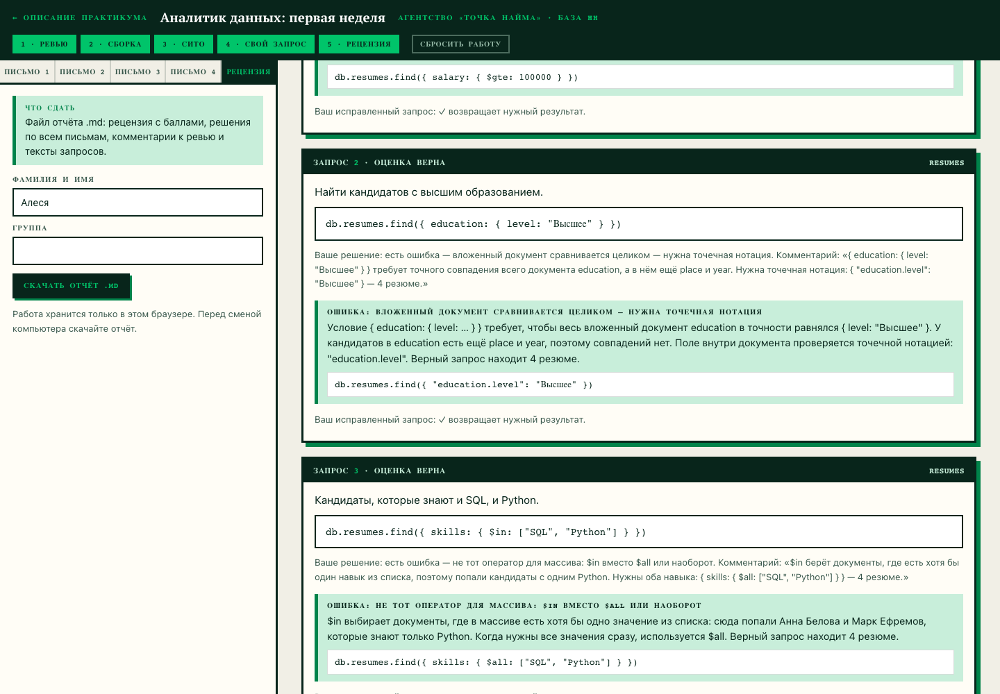

# Домашнее задание № 6 · Рецензия по практикуму «Аналитик данных»

**Студент:** Бацаценко Алеся Андреевна

Практикум: <https://maximbytecamp.github.io/mongodb_theory_makarov/praktiki/analitik/stol.html>

Отчёт — [`analitik_Алеся.md`](analitik_Алеся.md), файл не правился: в нём
рецензия руководителя отдела данных, решения по всем четырём письмам,
комментарии к ревью и тексты запросов.

## Итог

| Часть | Результат | Баллы |
|---|---|---|
| Письмо 1 · ревью | 8 из 8 | 3 / 3 |
| Письмо 2 · сборка | 5 из 5 | 3 / 3 |
| Письмо 3 · сито | 45 из 45 | 2 / 2 |
| Письмо 4 · свой запрос | 5 из 5 | 2 / 2 |
| **Итого** | | **10 / 10 · отлично** |

Что в отчёте:

- **Письмо 1:** шесть ошибочных запросов коллег разобраны по виду ошибки —
  строка вместо числа (`"100000"`), сравнение вложенного документа целиком
  (`{ education: { level: … } }`), `$in` вместо `$all`, отсутствие
  `$elemMatch`, шаблон без флага `i`, повтор ключа `salary` — с исправленными
  запросами; два верных запроса подтверждены;
- **Письмо 2:** пять заявок собраны из блоков: `$lt` вместо `$lte` теряет
  вакансию с границей ровно 80 000, `skills: ["SQL", "Python"]` требует точного
  массива, `$or` и `$elemMatch` собирают условия по-своему;
- **Письмо 3:** сито — все 45 карточек разложены верно, в том числе `$ne`
  с документами без поля и сравнение с `null`;
- **Письмо 4:** пять своих запросов: `$in` по двум городам, `updated` +
  `portfolio: { $exists: false }`, `"company.city": { $ne: "Москва" }`,
  `"skills.4": { $exists: true }` и `$expr` с `$subtract` для разницы вилки.

## Скриншоты

Рецензия за неделю: баллы по четырём письмам, итог 10 / 10.

Письмо 1: решение по запросу коллеги, разбор с верным запросом и проверка
исправленного запроса.

## Сдача

Ветка `hw-06`, Pull Request в свою `main`.
