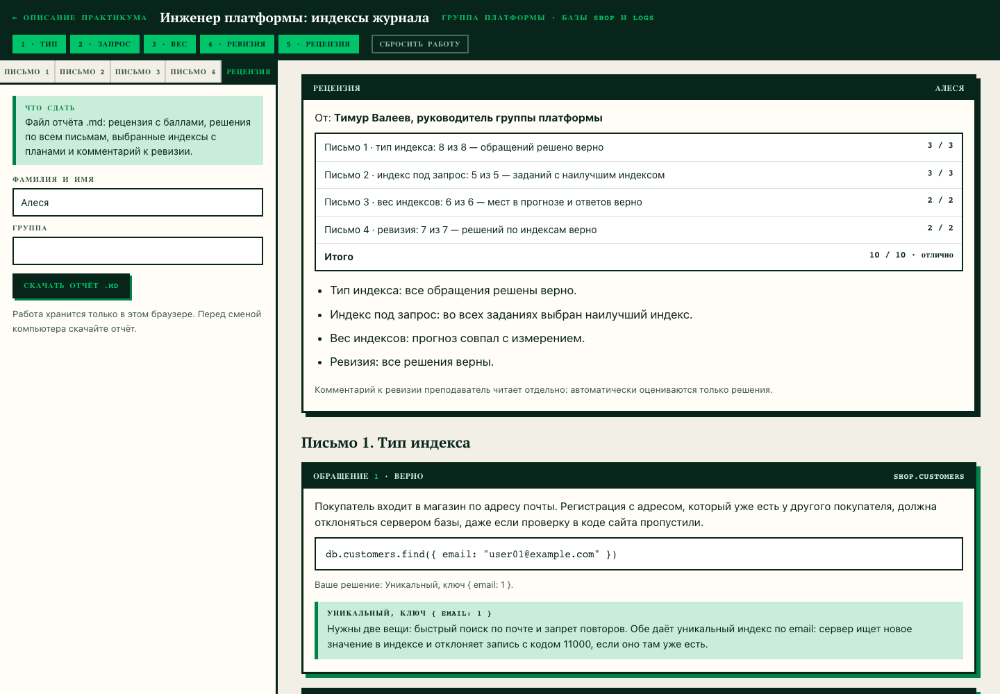
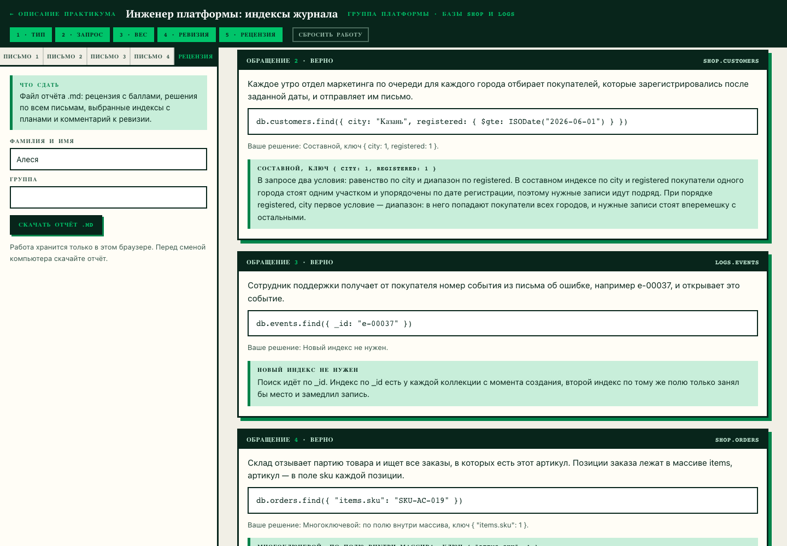

# Домашнее задание № 7 · Рецензия по практикуму «Инженер платформы»

**Студент:** Бацаценко Алеся Андреевна

Практикум: <https://maximbytecamp.github.io/mongodb_theory_makarov/praktiki/indeksy/stol.html>

Отчёт — [`indeksy_Алеся.md`](indeksy_Алеся.md), файл не правился: в нём
рецензия руководителя группы платформы, решения по всем четырём письмам,
выбранные индексы с планами сервера и комментарий к ревизии.

## Итог

| Часть | Результат | Баллы |
|---|---|---|
| Письмо 1 · тип индекса | 8 из 8 | 3 / 3 |
| Письмо 2 · индекс под запрос | 5 из 5 | 3 / 3 |
| Письмо 3 · вес индексов | 6 из 6 | 2 / 2 |
| Письмо 4 · ревизия | 7 из 7 | 2 / 2 |
| **Итого** | | **10 / 10 · отлично** |

Что в отчёте:

- **Письмо 1:** уникальный индекс по `email` и уникальный частичный — для
  покупателей без почты; составной `{ city: 1, registered: 1 }` (равенство,
  потом диапазон); многоключевой по `items.sku`; по `_id` и по `level: "info"`
  новый индекс не нужен — второй дублирует `_id_`, а `info` стоит у 777
  событий из 1200, при этом журнал пишется без перерыва;
- **Письмо 2:** пять индексов с планами `FETCH → IXSCAN` и
  `LIMIT → FETCH → IXSCAN` (в пятом задании индекс только по `duration_ms`),
  ключей и документов прочитано ровно столько, сколько возвращено, без `SORT`;
- **Письмо 3:** прогноз размеров совпал с измерением на 1 000 000 событий
  (`service_1` → `user_id_1` → `ts_1` → `trace_1`), оба вопроса калькулятора
  решены верно;
- **Письмо 4:** оставлены `service_1_status_1`, `route_1_ts_-1`, `trace_1`
  и `_id_`; удалены `service_1` (префикс составного), `status_1_service_1`,
  `level_1` и `user_id_1_ts_1` — комментарий к ревизии в конце отчёта.

## Скриншоты

Рецензия за всю неделю: баллы по четырём письмам, итог 10 / 10.

Письмо 1: принятое решение по обращению и разбор с верным типом индекса и ключом.

## Сдача

Ветка `hw-07`, Pull Request в свою `main`.
