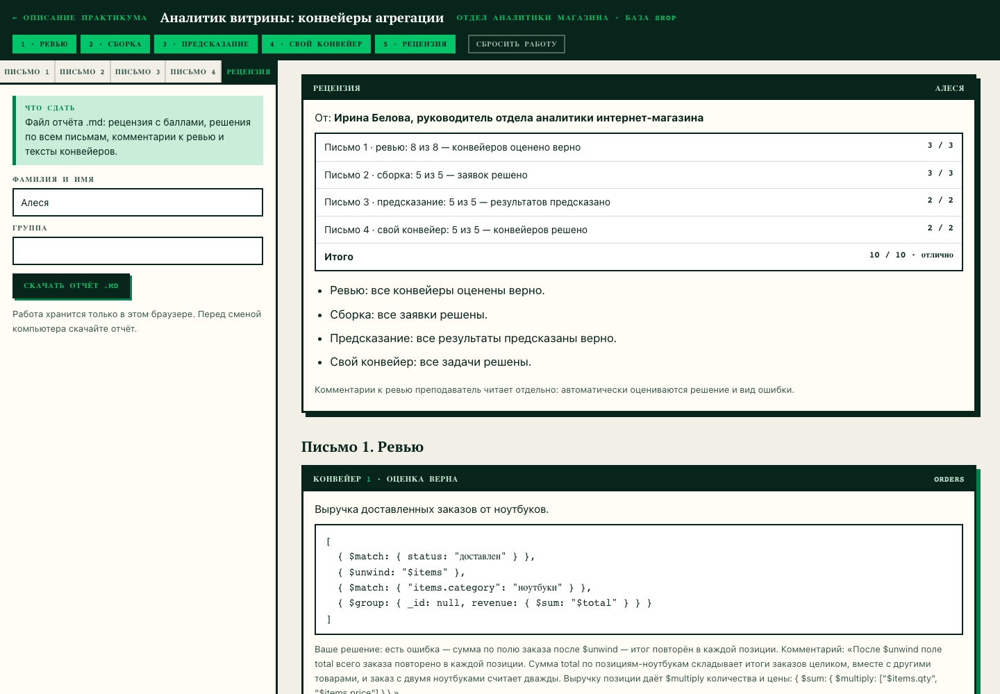
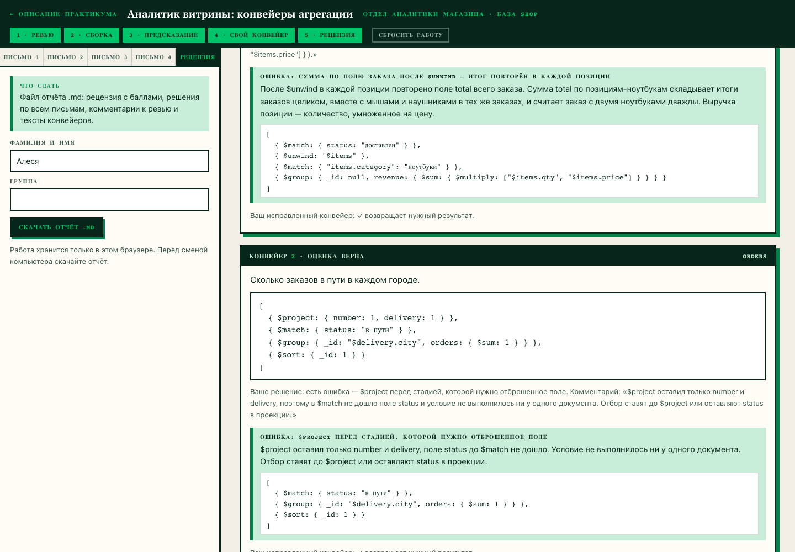

# Домашнее задание № 8 · Рецензия по практикуму «Аналитик витрины»

**Студент:** Бацаценко Алеся Андреевна

Практикум: <https://maximbytecamp.github.io/mongodb_theory_makarov/praktiki/konveyer/stol.html>

Отчёт — [`konveyer_Алеся.md`](konveyer_Алеся.md), файл не правился: в нём
рецензия руководителя отдела аналитики, решения по ревью, собранные и
написанные конвейеры с числом запусков и выбранные результаты предсказаний.

## Итог

| Часть | Результат | Баллы |
|---|---|---|
| Письмо 1 · ревью | 8 из 8 | 3 / 3 |
| Письмо 2 · сборка | 5 из 5 | 3 / 3 |
| Письмо 3 · предсказание | 5 из 5 | 2 / 2 |
| Письмо 4 · свой конвейер | 5 из 5 | 2 / 2 |
| **Итого** | | **10 / 10 · отлично** |

Что в отчёте:

- **Письмо 1:** шесть ошибочных конвейеров разобраны по виду ошибки — сумма
  `total` после `$unwind`, `$project` до `$match`, `$first` без `$sort`,
  `$limit` до отбора, путь без `$` и условие на элемент массива до `$unwind`;
  два верных конвейера подтверждены;
- **Письмо 2:** пять конвейеров собраны из стадий: `$match` → `$sort` →
  `$limit` → `$project`, `$sort` дважды вокруг `$group` с `$first`,
  `$bucket` с четырьмя границами на три корзины;
- **Письмо 3:** результаты пяти конвейеров по заказам c-007 предсказаны до
  запуска — выбран верный вариант из четырёх, в отчёте для каждого указан
  вариант и сам результат;
- **Письмо 4:** пять своих конвейеров: `$group` с двумя аккумуляторами,
  `$round` в `$project`, `$match` после `$group` (условие на `spent`),
  `$push` с сортировкой по номеру до группировки и `$facet` с двумя ветками
  (`$count` и топ-три товаров).

## Скриншоты

Рецензия за всю неделю: баллы по четырём письмам, итог 10 / 10.

Письмо 1: решение по конвейеру коллеги, разбор с исправленным конвейером
и проверка результата.

## Сдача

Ветка `hw-08`, Pull Request в свою `main`.
